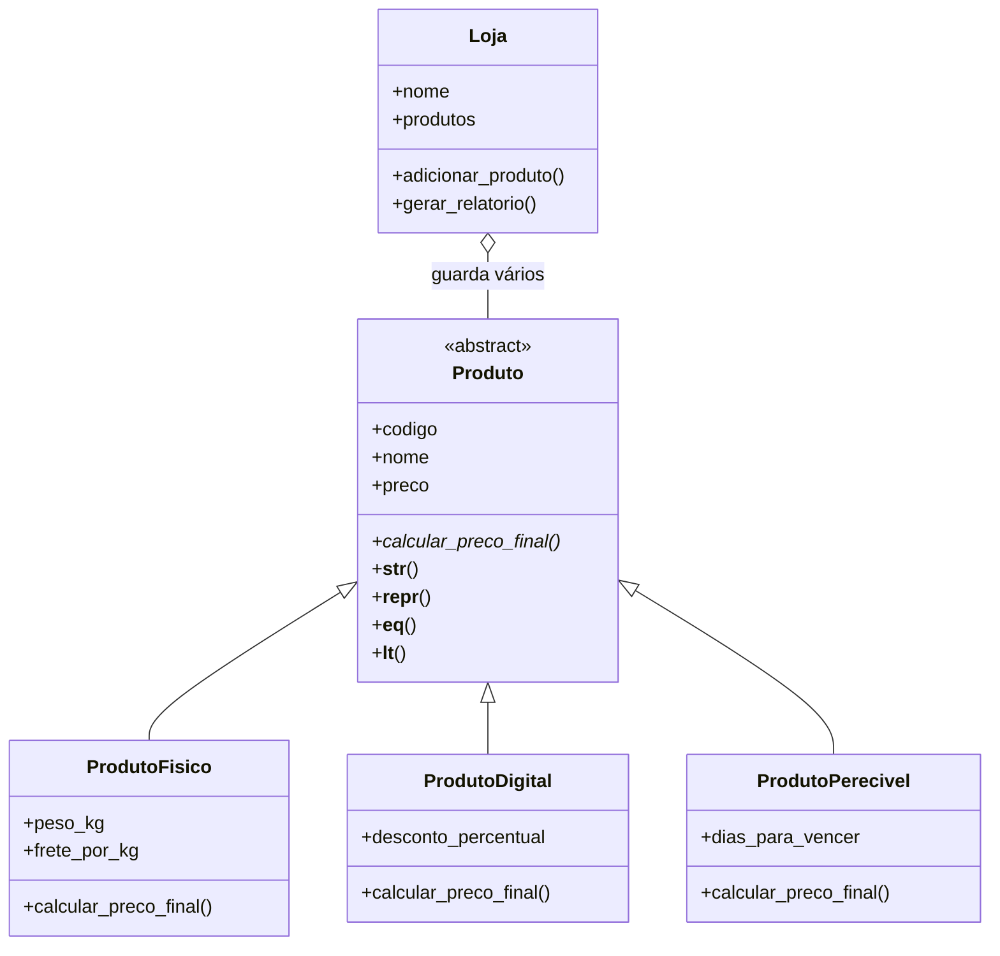

# Sprint 6 - Sistema de Loja com Programação Orientada a Objetos

## Sobre o projeto

Neste trabalho, eu continuei com o tema de produtos das sprints anteriores, mas agora usando **Programação Orientada a Objetos (POO)**.

Criei uma loja que guarda produtos de três tipos: físicos, digitais e perecíveis. Cada tipo tem uma forma diferente de calcular seu preço final. Assim, consigo mostrar na prática classes, objetos, herança, encapsulamento e polimorfismo.

Usei apenas recursos do próprio Python, sem precisar instalar bibliotecas externas.

## Arquivos do projeto

- `produtos.py`: contém as classes dos produtos.
- `loja.py`: contém a classe `Loja`, que armazena os produtos e monta o relatório.
- `main.py`: cria 10 produtos e mostra o programa funcionando.
- `teste_sistema.py`: contém os testes automatizados.
- `saida_exemplo.txt`: mostra o que aparece no terminal quando o programa roda.
- `.gitignore`: evita adicionar arquivos temporários ao GitHub.

## Diagrama de classes



## Como pensei nas classes

Eu usei a classe **`Produto`** como classe mãe, porque todos os produtos têm código, nome e preço. Ela é **abstrata**, feita com `ABC` e `@abstractmethod`. Por isso, ela não pode ser usada para criar um produto diretamente.

As classes **`ProdutoFisico`**, **`ProdutoDigital`** e **`ProdutoPerecivel`** herdam de `Produto`, pois cada uma **é um tipo de produto**. Utilizei `super().__init__(...)` para aproveitar o construtor da classe mãe.

Já a **`Loja`** não herda de `Produto`, porque uma loja não é um produto. Ela **tem produtos**. Por isso usei composição: a loja guarda uma lista desses objetos.

## Como os preços são calculados

- **Produto físico:** preço inicial + (peso em kg × frete por kg). No exemplo, o frete padrão é R$ 8,00 por kg.
- **Produto digital:** preço inicial com um desconto percentual informado ao criar o produto.
- **Produto perecível:** desconto de 20% quando faltam até 3 dias para vencer. Com mais de 3 dias, mantém o preço inicial.

Essas são regras de exemplo que escolhi para demonstrar o funcionamento das classes.

## Encapsulamento e validações

Usei `@property` e os setters para verificar os valores antes de guardá-los. Por exemplo:

- O código precisa ser um número inteiro positivo.
- O nome não pode ser vazio.
- O preço e o frete não podem ser negativos, nem valores como infinito e `NaN`.
- O peso de um produto físico deve ser maior que zero.
- O desconto de um produto digital deve estar entre 0 e 100.
- Os dias para vencer precisam ser um número inteiro a partir de zero.
- A loja não permite cadastrar dois produtos com o mesmo código.

Se algum valor estiver errado, o programa gera um `ValueError` (ou um `TypeError`, no caso de tentar cadastrar algo que não é produto). No `main.py`, usei `try/except` para mostrar uma mensagem em vez de interromper o programa.

## Polimorfismo

Eu criei o método `calcular_preco_final()` na classe abstrata e fiz esse método de maneira diferente nas três classes filhas.

Depois, no `main.py`, coloquei objetos dessas classes na mesma lista e usei um único `for` para chamar o método. Cada objeto calcula o preço de acordo com sua classe:

```python
for produto in loja.produtos:
    print(produto.calcular_preco_final())
```

## Métodos especiais

- `__init__`: configura os dados do objeto quando ele é criado.
- `__str__`: mostra uma descrição fácil de ler.
- `__repr__`: mostra uma representação resumida do objeto.
- `__eq__`: compara produtos pelo código.
- `__lt__`: permite ordenar produtos pelo preço final com `sort()`.

Todas as cinco classes possuem `__init__` e `__str__` (na classe `Produto` eles servem de base para as filhas, que também definem os seus).

## Como executar

1. Baixe os arquivos ou clone o repositório.
2. Abra a pasta do projeto no VS Code.
3. No terminal, execute:

```bash
python main.py
```

Se `python` não funcionar no Windows, você pode tentar `py main.py`.

O programa já cria **10 produtos** para demonstrar os recursos pedidos. Você não precisa digitar esses produtos no terminal.

## Exemplo de saída

Uma parte do resultado mostrado pelo programa:

```text
SISTEMA DE PRODUTOS - SPRINT 6
Loja da Sprint 6 - 10 produto(s) cadastrado(s)

POLIMORFISMO: PREÇOS DE CADA TIPO
Caderno (físico) | Preço final: R$ 18.70
E-book de Python (digital) | Preço final: R$ 36.00
Leite (perecível) | Preço final: R$ 6.00

TRATAMENTO DE ERROS
Não foi possível cadastrar: O preço precisa ser um número válido e não negativo.
Não foi possível cadastrar: Já existe um produto com o código 1.
```

O arquivo `saida_exemplo.txt` contém a saída completa, inclusive o relatório com total, menor preço, maior preço e média.

## Como executar os testes

No terminal, dentro da pasta do projeto:

```bash
python -m unittest -v teste_sistema.py
```

Preparei **23 testes** para conferir os cálculos, as validações, a classe abstrata, a ordenação, os métodos especiais e a classe `Loja`. O resultado esperado termina com `OK`.

